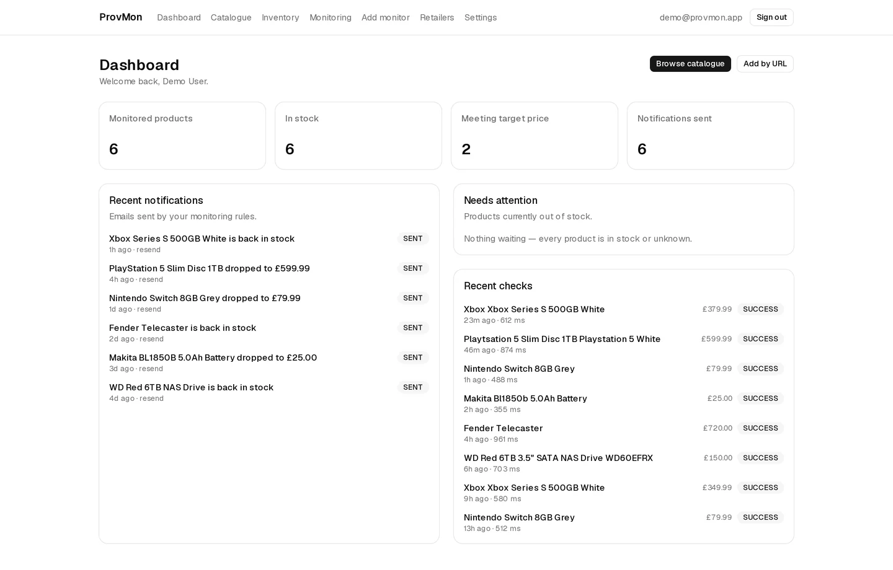
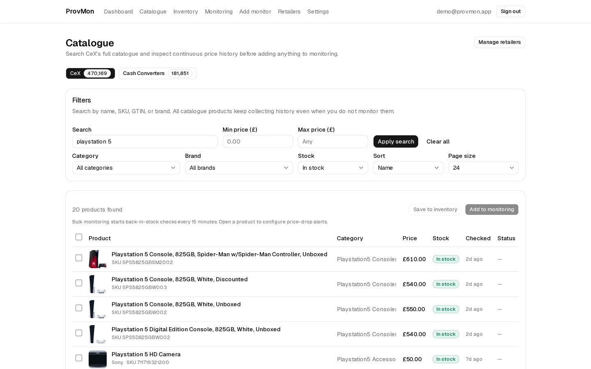
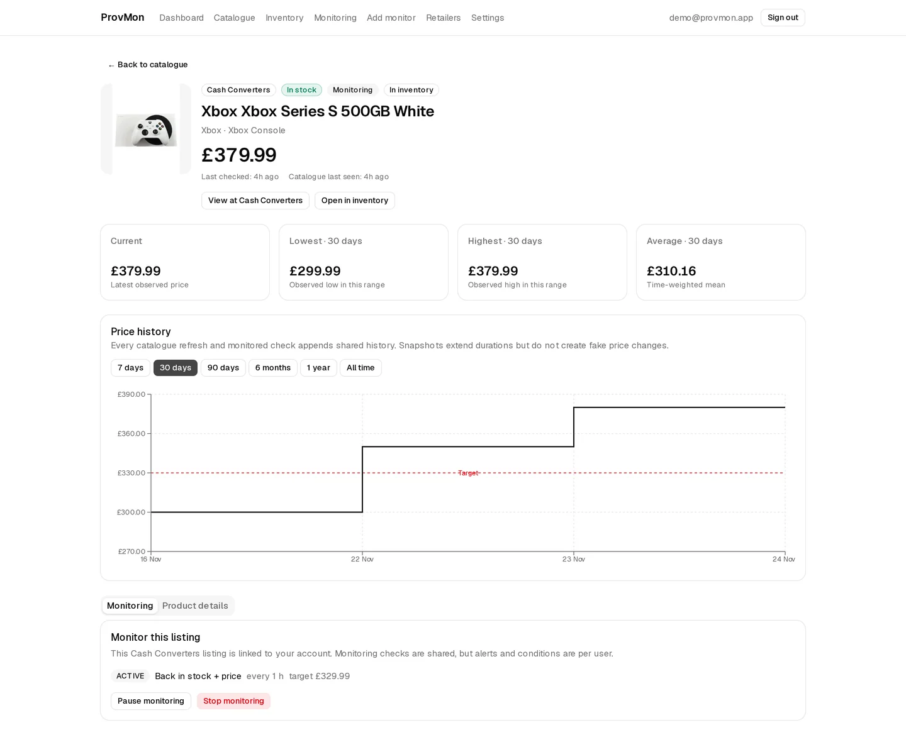
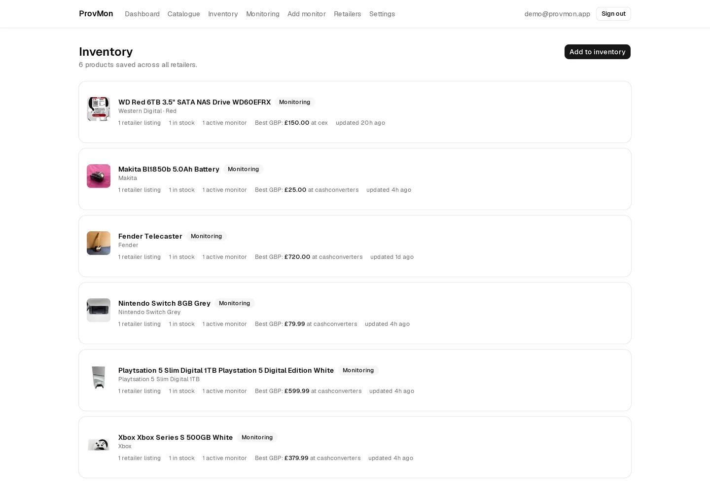
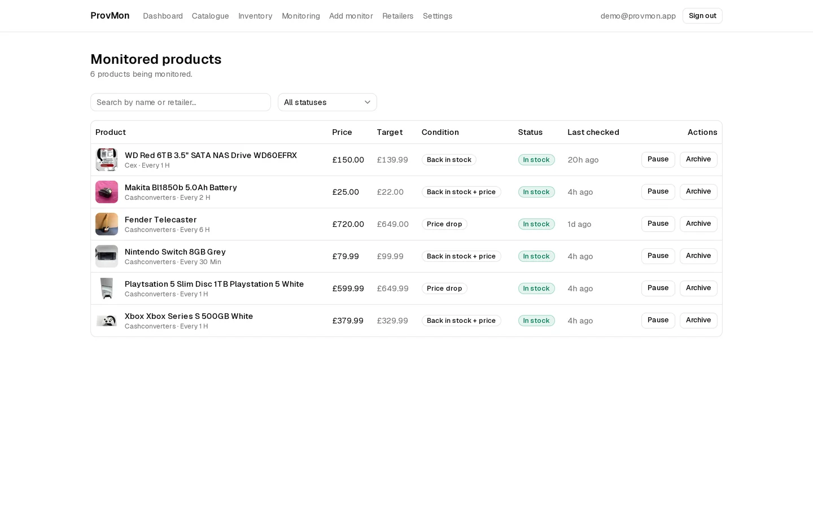
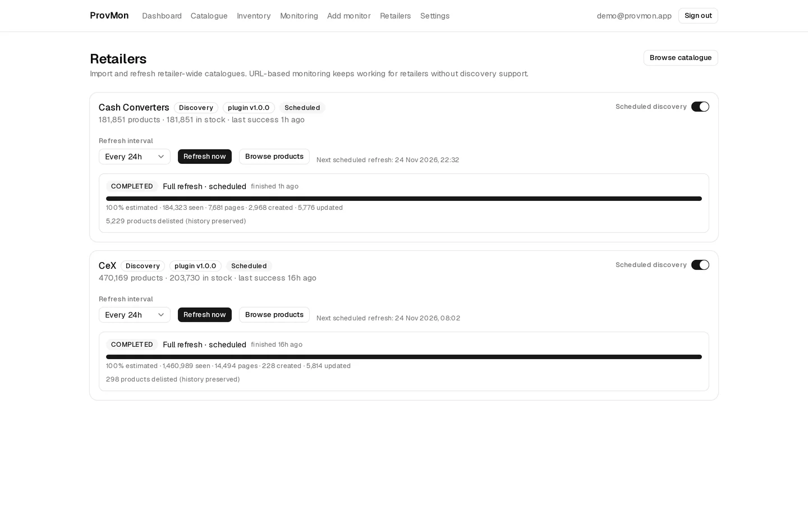

# ProvMon

Multi-retailer product price & stock monitoring platform. Browse a retailer's
full catalogue with continuous shared price history, then paste a product URL
or add a catalogue product to monitoring and get email notifications when it
comes back in stock or drops to your target price.



## Features

- **Retailer-wide catalogue discovery** — import a retailer's full catalogue and refresh it on a schedule.
- **Continuous shared price history** — every catalogue refresh and monitoring check appends observations, so history builds for products whether or not anyone is monitoring them.
- **Flexible monitoring** — monitor a supported product URL or a catalogue listing with back-in-stock and target-price conditions.
- **Email alerts** — send notifications through Resend, with per-user preferences, configurable check intervals, and a local Mailpit fallback for development.
- **Cross-retailer inventory** — save products once and see current availability and the best price across their listings.
- **Plugin-based retailers** — retailer integrations are external npm packages implementing [`@provmon/retailer-plugin-sdk`](packages/retailer-plugin-sdk), keeping retailer-specific code out of the core app.

## Screenshots

### Retailer-wide catalogue

Search a retailer's full catalogue and filter by category, brand, stock, and
price. Every listing collects price history, whether or not it is being
monitored.



### Shared price history

Catalogue refreshes and monitoring checks append to the same timeline. Set a
target price and compare it with the observed range and current listing price.



### Inventory

Save products to a cross-retailer inventory and see availability, monitoring
status, and the best current price.



### Monitoring

Manage monitoring conditions, targets, check intervals, and status for every
tracked product.



### Retailer plugins

Catalogue discovery runs, plugin status, and refresh schedules are managed per
retailer.



_Screenshots use demo data._

## Stack

- **Frontend/backend**: Next.js 16 (App Router), TypeScript
- **UI**: Tailwind CSS v4, shadcn/ui (radix-nova preset)
- **Database**: PostgreSQL via Prisma ORM 7 (driver adapter)
- **Background jobs**: Redis + BullMQ
- **Email**: Resend (dev delivery via Mailpit)
- **Validation**: Zod v4
- **Auth**: Auth.js v5 (credentials, JWT sessions, bcrypt)
- **Tests**: Vitest

## Architecture

Retailer integrations are external plugins, not part of the core codebase.
ProvMon discovers installed packages, validates their manifests and
configuration, and adapts them to the internal retailer interface. The
monitoring engine, catalogue importer and notification rules only ever see
normalised product data.

A plugin is an npm package implementing
[`@provmon/retailer-plugin-sdk`](packages/retailer-plugin-sdk) and shipping a
`provmon.plugin.json` manifest. Plugins are loaded from the deployment-owned
`plugins/` directory. See
[`docs/plugin-architecture.md`](docs/plugin-architecture.md) and
[`docs/plugin-development.md`](docs/plugin-development.md).

Discovery-capable plugins expose the optional catalogue capability. Their
products are imported into a shared catalogue with continuous price history;
monitoring remains optional and per user. See
[`docs/catalogue-discovery.md`](docs/catalogue-discovery.md) for the data
model, schedules, discovery flow, and API.

Domain modules live in `src/modules/` and are free of Next.js imports so they
can be tested in isolation. The web app is a thin layer in `src/app`.

## Getting started

### 1. Infrastructure

A `docker-compose.yml` provides PostgreSQL, Redis, and Mailpit (local email
testing at <http://localhost:8025>).

```bash
docker compose up -d          # Docker
podman-compose up -d          # Podman (no Docker required)
```

If port 5432 is already taken on your machine, set `POSTGRES_PORT=5433` in
`.env` before starting the stack.

### 2. Environment

```bash
cp .env.example .env
# set AUTH_SECRET: openssl rand -base64 32
```

### 3. Database

```bash
npm install        # runs `prisma generate` via postinstall
npm run db:migrate # applies migrations (creates tables)
```

### 4. Run

```bash
npm run dev        # web app on http://localhost:3100
```

The dev and production servers default to port `3100` (set `PORT` to override).
The production compose stack maps the container's port `3100` to
`APP_PORT` on the host (default `3100`):

```bash
podman compose -f docker-compose.yml -f compose.prod.yml up -d --build
```

### 5. Retailer plugins

ProvMon ships without retailer integrations. Install the plugin packages you
need into `plugins/`, list them in `plugins/provmon.plugins.json`, configure
their declared environment variables, and restart:

```bash
npm run plugins:list
npm run plugins:validate
```

See [`docs/plugin-development.md`](docs/plugin-development.md) for the plugin
contract, template and installation workflow.

## Scripts

| Command                    | Purpose                          |
| -------------------------- | -------------------------------- |
| `npm run dev`              | Dev server (Next.js)             |
| `npm run build`            | Production build                 |
| `npm run build:sdk`        | Build the plugin SDK workspace   |
| `npm run lint`             | ESLint                           |
| `npm run typecheck`        | TypeScript check (builds SDK first) |
| `npm test`                 | Vitest (single run)              |
| `npm run test:watch`       | Vitest (watch mode)              |
| `npm run db:migrate`       | Create/apply Prisma migrations   |
| `npm run db:generate`      | Regenerate the Prisma client     |
| `npm run plugins:list`     | List installed retailer plugins  |
| `npm run plugins:validate` | Validate manifests and plugin config |
